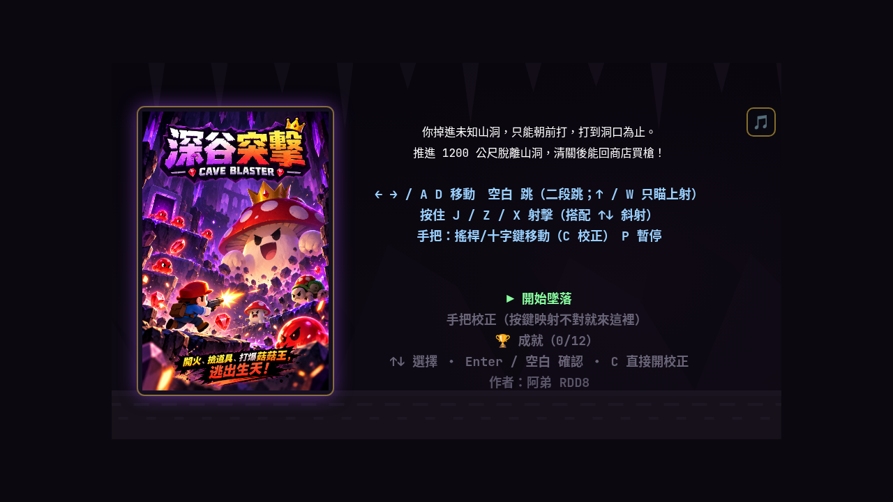
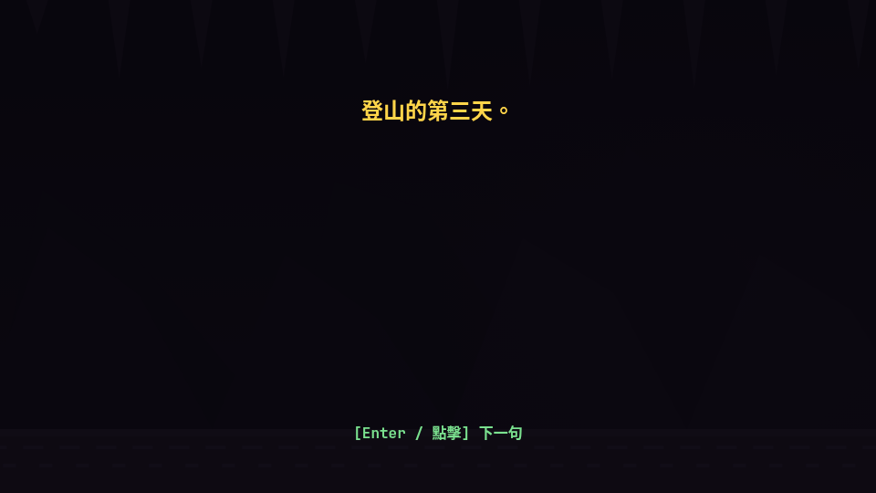
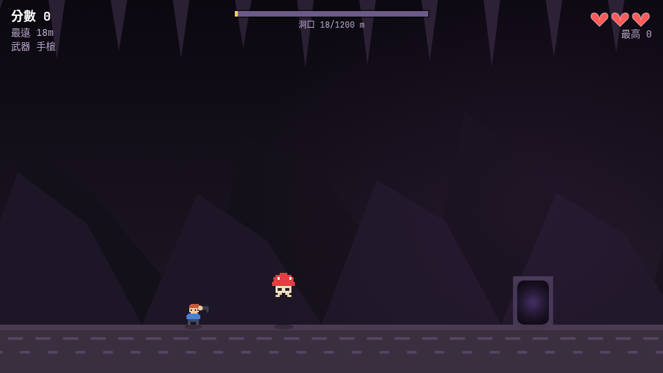
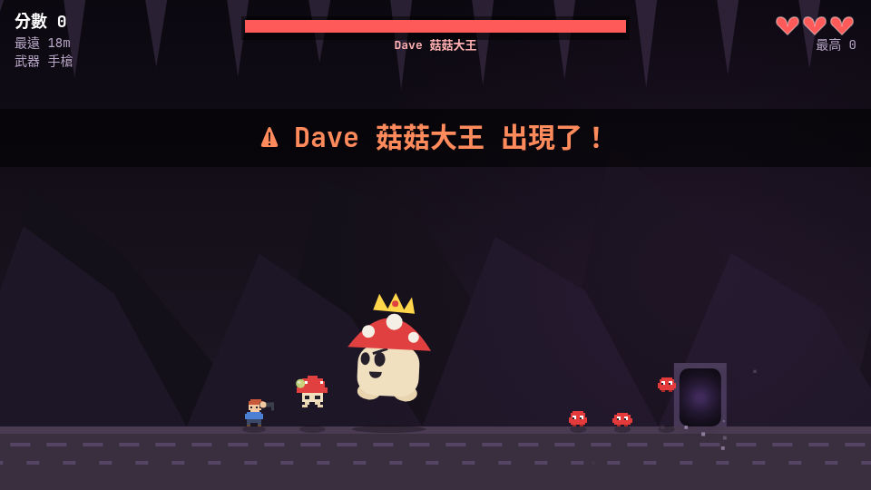
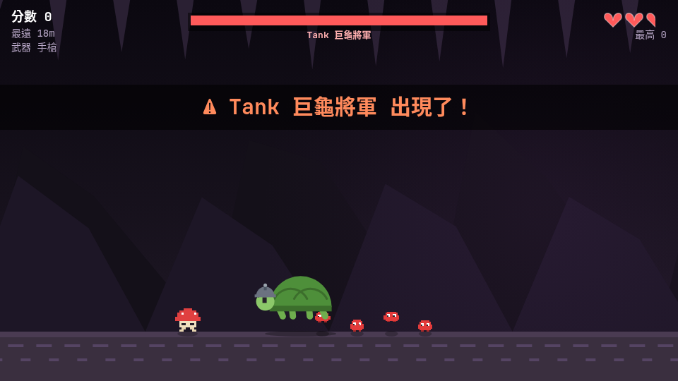
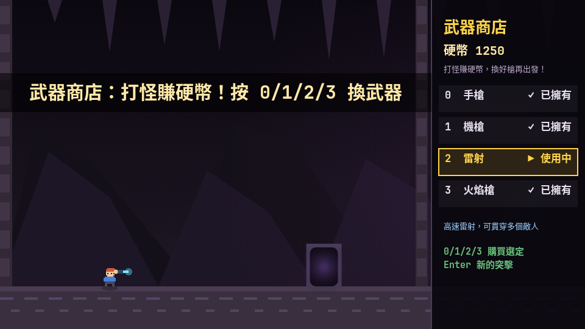
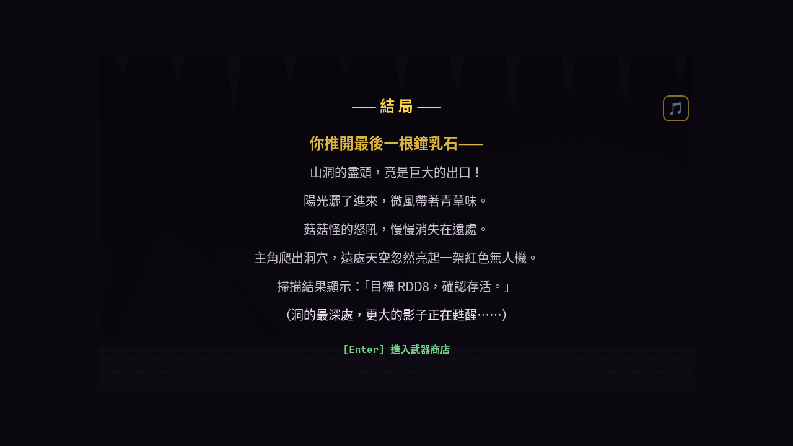
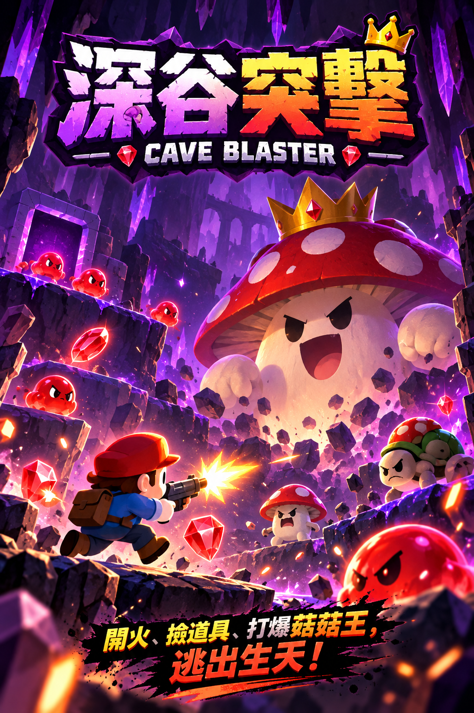

# 深谷突擊 Cave Blaster 🤖

**作者：阿弟 RDD8**

2D 側視角射擊遊戲（網頁版）：純 HTML5 Canvas + JavaScript，**零依賴**，開瀏覽器就能玩。

登山的第三天，步道崩裂，你掉進未知山洞——手裡只有一把槍，前方 1200 公尺才是出口。
一路打穿菇菇怪、烏龜、成群的紅紅怪與彈來彈去的彈彈怪，躲避打不死、在空中俯衝的**暗影獵手**，
推矮鐘乳石柱，擊敗 **Dave 菇菇大王**、**Tank 巨龜將軍**、最後最兇的**怒怒 紅紅怪王**，逃出生天後去**武器商店**把硬幣換成更好的槍。

| 標題 | 開場故事 | 關卡 | Boss：Dave 菇菇大王 |
| --- | --- | --- | --- |
|  |  |  |  |

| Boss：Tank 巨龜將軍 | 武器商店 | 結尾（無人機揭示主角身分）|
| --- | --- | --- |
|  |  |  |

## 遊戲封面（美術參考）

<table><tr>
<td align="center"></td>
<td><b>開火、撿道具、打爆菇菇王，逃出生天！</b><br>封面為本作美術準繩：紫水晶洞配色、菇菇大王金冠立繪、紅紅怪／巨龜造型、石拱洞門。</td>
</tr></table>


## 玩法

直接用瀏覽器打開 `index.html` 即可；或用任何靜態伺服器：

```bash
npx serve .
# 或
python3 -m http.server 8000
```

標題畫面左側是遊戲封面立繪；右上角血量區下方有 **🎵 BGM 按鈕**隨時開關背景音樂（WebAudio 即時合成、無音檔，偏好會記住）。

## 遊戲流程

```
標題 → 開場故事 → 關卡（推進 1200m，殺敵賺硬幣＋分數）
              ├─ 300m：⚠ 暗影獵手出沒（打不死、空中懸浮＋俯衝，甩掉它或用石柱當護盾）
              ├─ 300/550/800/1050m：鐘乳石柱（按住方向推下變矮，推矮即可二段跳跳過）
              ├─ 400m：Boss 巨門 → Dave 菇菇大王
              ├─ 700m：Boss 巨門 → Tank 巨龜將軍
              ├─ 1000m：Boss 巨門 → 怒怒 紅紅怪王（死亡觸發慢動作，分裂 3 隻第二階段怒奴）
              └─ 1200m：洞口 → 結局故事 → 武器商店
死亡 → 死亡動畫（趴下 + 靈魂飄走）→ 結束畫面（R 重試 / S 去商店）
武器商店：花硬幣買槍＋升級（不刷怪、純買賣）→ 0/1/2/3 買槍選槍、4/5 武器升級 → Enter 新的突擊
```

- 每隻 Boss 登場都有**黑屏特寫**：巨幅立繪＋名字橫幅，戰鬥短暫凍結 1.4 秒。

- 硬幣、已購買的武器、選定的武器、武器升級等階、累計進度與成就解鎖都會存進 `localStorage`，下次直接沿用。
- 每一代 Boss 都比上一代更耐打（第 N 代血量隨代數成長）。

## 關卡變體與 Boss 舞台

**關卡輪替**：每次「新的突擊」（商店 → Enter）輪替關卡主題：
**紫晶深洞 → 冰晶洞 → 熔岩洞**（背景漸層 / 岩壁 / 地面 / 鐘乳石柱 / 晶體整套換色），再循環。
重試（R）不換關。

**Boss 專屬舞台**：每隻 Boss 巨門前 100m，場景短暫切換該 Boss 的專屬配色
（Dave＝白紫孢子色 / Tank＝鋼青灰 / 怒怒＝暗紅），橫幅「進入「～」的領地……」；擊倒後還原關卡主題。

**關卡機制**（各洞有性格）：
- **冰晶洞**：地面很滑（摩擦 0.97 / 加速 0.5），放開方向鍵會滑好一段才停
- **熔岩洞**：地面升起火星粒子（環境氛圍）；**冰晶洞**：飄落冰晶
- **暗影獵手**：懸浮高度／位置會隨機漂移，不會固定在同一點

## 操作

| 按鍵 | 功能 |
| --- | --- |
| `←` `→` / `A` `D` | 左右移動（貼著鐘乳石柱時 = 推開它） |
| `空白`（Space） | 跳躍（二段跳） |
| `↑` / `W` | 朝上瞄準（不再跳；地上按 `↑`＋射擊 = 斜上射） |
| 按住 `J` / `Z` / `X` / `Enter` | 射擊（搭配 `↑` / `↓` 可斜著射；`Enter` = steamOS 模擬鍵盤手把的備援） |
| `P` | 暫停 / 繼續 |
| `Enter` | 開始 / 下一句故事 / 確認 |
| `R` | 結束畫面：再試一次 |
| `S` | 結束畫面：去武器商店 |
| `0` `1` `2` `3` | 商店：購買 / 選定武器 |
| `4` `5` | 商店：武器升級（傷害強化 / 射速強化） |
| `C` | 標題畫面：直接進手把校正 |
| `↑` `↓`（標題） | 標題選單：開始墜落 / 手把校正 / 成就 |
| `Enter` / `Esc`（成就頁） | 返回標題 |
| 🎵 按鈕（右上角血量區下方） | BGM 開／關（偏好存檔，下次沿用） |

**手把（Gamepad API，接上就能玩，按鍵可自訂）**

| 手把 | 功能 |
| --- | --- |
| 左搖桿 / 十字鍵 | 移動 |
| 十字鍵上 / 下 | 上射 / 下射（標題選單上下切換） |
| 跳躍鍵（預設 A） | 跳躍 |
| 射擊鍵（預設 X）/ LT / RT / LB / RB | 射擊 |
| 確認鍵（預設 Start） | 開始 / 確認 / 新的突擊 |
| 暫停鍵（預設 B） | 暫停（結束畫面 = 去商店） |

> **按鍵不準？標題選單「手把校正」（或按 `C`）**：三步分別指定跳躍 / 射擊 / 確認鍵，
> 畫面會即時亮出你實際按到的按鍵格子（各廠牌手把映射不同，所以改成自訂）；映射存 localStorage。
>
> **Steam Deck / steamOS 玩家**：手把模式下的瀏覽器常「未偵測到手把」（平台限制，
> 輸入被轉成鍵盤）——移動、跳躍有效但射擊按不到。對策：① 遊戲中按 `Enter` 射擊；
> ② 改「模擬鍵盤／滑鼠」的控制器模板；③ 用桌面模式的瀏覽器。（校正畫面會顯示診斷與這些對策）

**手機 / 平板觸控**（觸控裝置自動顯示虛擬按鈕，選單畫面也能完整操作）

| 按鈕 | 遊戲中 | 選單畫面（標題 / 商店 / 死亡 / 暫停）|
| --- | --- | --- |
| ◀ / ▶ | 左 / 右移動 | 移動游標（◀＝上、▶＝下）|
| 跳 鍵 | 跳躍（二段跳）| **確認**（按鈕標籤自動變「確認」）|
| 射擊 | 射擊 | — |
| ⏸（右上角）| 暫停 / 繼續 | — |

> **手機怎麼進武器商店**：① 清關（1200 公尺）結尾後自動進；② 死亡畫面按 ▶ 選到「去武器商店」再按「確認」。進商店後 ◀▶ 選列、「確認」購買／切換武器／開始新的突擊。

> **iPhone / iPad（Safari）**：
> - 橫向畫面已修好底部被裁的問題（用 `100dvh` 動態視口高度，自動避開 Safari 列）。
> - **想全螢幕玩**：Safari 右上角「分享」→「新增至主畫面」（iOS 16.4+ 也會出現安裝橫幅），從主畫面用「深谷突擊」圖示開啟＝無瀏覽器欄、直接橫向（iOS 16.4+ 為真正全螢幕）。

## 怪物（全部從洞門裡竄跳出來，還會反擊！）

| 怪物 | 血量 | 分數 | 行為 |
| --- | --- | --- | --- |
| 菇菇怪 🍄 | 3 | 100 | 一直彈跳靠近你，起跳丟**拋物線孢子** |
| 烏龜 🐢 | 4 | 200 | 慢慢走向你，近身噴**三發殼刺** |
| 紅紅怪 👾 | 2 | 50 | 又小又多又兇，遠距離朝你**吐酸液**（射程很遠） |
| 怒奴 🌑 | 130 | 500 | 怒怒慢動作死亡後分裂的**第二階段**：**Boss 級身形（64×60）＋獨立暗紅尖刺造型**（非紅怪換色）、吐**三發暗紅酸液**；**畫面中央 3 條 Boss 級血量條**（①②③ 各佔一條）；**集體攻擊**：同場 ≥2 隻時定期飛向畫面邊緣 3 個 slot（有高有低）同時朝主角**三發扇形齊射（彈雨）** |
| 彈彈怪 ⚪ | 4 | 250 | 稀有門怪（12%）：永遠彈跳、撞牆/石柱反彈，吐**高彈速直線子彈** |

**暗影獵手 🌑**（300m 出沒，每關 1 隻）：子彈**完全無效**，從空中出現後在**主角頭頂隨機懸浮**（高度 140~215px、位置 ±90px，每隔 0.9~2.3s 漂移一次，不會固定），
偶爾頭頂閃紅「！」預警後**俯衝下來**干擾（8.2 快於主角但躲得掉）；
碰到扣 **1 顆心（2 半顆）**＋強擊退＋2 秒冷卻，靠近時會紅光脈動＋心跳聲。
對付方式：**(a)** 一直跑甩開（追速 3.0 < 主角 4.2），拉開 >700px 保持 5 秒→消散；
**(b)** 俯衝撞**未推下的鐘乳石柱會反彈**——石柱就是護盾，站柱子旁邊等它撞；
**(c)** 約 45 秒後自動飛離；**(d)** 900m 處劇情光柱掃過強制消散。

門出現前會先紅色閃爍警示；Boss 巨門更大、頂上有王冠紋。

## Boss

| Boss | 登場 | 招式 |
| --- | --- | --- |
| **Dave 菇菇大王**（戴王冠） | 400m | 5 發扇形孢子 / 衝撞拍地（震屏）/ **孢子雨**（孢子從天墜落）/ 召喚菇菇（2 代起 3 隻） |
| **Tank 巨龜將軍**（戴鋼盔） | 700m | **縮殼週期**：伸頸 4.5s 可攻擊（7 發殼刺扇形 / **殼刺漩渦** 12 發 / 召喚紅紅怪 2 代起 3 隻）↔ 縮進龜殼**無敵**（最多衝撞主角 3 次，**第 3 次觸發落石**：9 顆石頭墜落＋地面留碎石，要二段跳躲）；HP 歸零時**從殼裡掉出終結形態**（**0.35× 慢動作電影感**、主角被震暈 1.1s、一發子彈擊殺立刻恢復正常速度） |
| **怒怒 紅紅怪王**（刺鬃紅魔王） | 1000m | **酸液三連噴**（3 發高速直線）/ 高速衝撞（比 Tank 還快）/ **尖刺放射**（10 發）；**死亡觸發 0.3× 慢動作**，懸停後**分裂成 3 隻第二階段「怒奴」**（Boss 級身形 64×60、**Boss 等級血量 130**、更兇、定期**集體攻擊齊射**） |

擊倒 Boss：+2000 分、+100 硬幣、+1 顆心、掉落 3 個道具。
同一種 Boss 再登場會變成「N 代」：血量大幅成長（King 110 起、Red 130 起、Tank 150 起）、彈速更快、攻擊冷卻更短。

## 武器與商店

| 按鍵 | 武器 | 硬幣 | 特點 |
| --- | --- | --- | --- |
| `0` | 手槍 | 0（預設） | 均衡萬用，無後顧之憂 |
| `1` | 機槍 | 300 | 超高射速，掃平怪群 |
| `2` | 雷射 | 600 | **一直線光束**，貫穿整排敵人（傷害 2） |
| `3` | 火焰槍 | 400 | 短距離火焰錐，近身融化一切 |

**經濟規則**：**關卡內殺敵賺硬幣**（紅紅怪 8 / 菇菇怪 15 / 烏龜 25 / 彈彈怪 30 / 怒奴 40、Boss +100）同時加分數；
**武器商店純買賣**（不刷怪）——花硬幣買槍。買過的武器永久保留；選定的武器會帶進下一場突擊。

**武器升級**（商店按鍵 `4` / `5`，永久生效、存 localStorage）：

| 按鍵 | 升級 | 效果 | 各等階成本 | 上限 |
| --- | --- | --- | --- | --- |
| `4` | 傷害強化 | 所有武器傷害 +0.5/級 | 120 / 240 / 360 / 480 / 600 | Lv5 |
| `5` | 射速強化 | 所有武器射擊間隔 ×0.93/級 | 150 / 300 / 450 / 600 / 750 | Lv5 |

商店下方會顯示目前等階（如「傷害 Lv3/5」），滿級後顯示 MAX。

## 成就系統

12 個成就，解鎖後永久保存（localStorage），標題選單第三項「🏆 成就」可看完整列表（✅ 已解鎖 / 🔒 未解鎖）；解鎖當下畫面會彈橫幅＋音效。

| 成就 | 名稱 | 條件 |
| --- | --- | --- |
| 🗡️ | 初嘗鮮血 | 擊敗第一隻敵人 |
| ⚔️ | 怪物獵人 | 累計擊殺 10 隻敵人 |
| 💥 | 深谷屠夫 | 累計擊殺 50 隻敵人 |
| 👑 | 討伐者 | 擊倒第一隻 Boss |
| 🍄 | 菇菇斬 | 擊倒 Dave 菇菇大王 |
| 🐢 | 平定巨龜 | 擊倒 Tank 巨龜將軍 |
| 🔥 | 怒平 | 擊倒怒怒 紅紅怪王 |
| 🌅 | 深谷逃脫 | 推進 1200m 清關 |
| 💰 | 硬幣大亨 | 持有 1000 硬幣 |
| 🔫 | 全武裝 | 集齊 4 種武器 |
| ⬆️ | 武裝升級 | 首次購買武器升級 |
| ★ | 極致武裝 | 任一升級滿 Lv5 |

## 道具

| 道具 | 效果 |
| --- | --- |
| P（紅） | 連發 8 秒（射速 ×2） |
| S（藍） | 散射 8 秒（一次三發） |
| +（綠） | 加 1 顆心（血量滿則 +200 分） |
| ★（金） | +300 分 |

掉率：烏龜 30%、怒奴 25%、菇菇 18%、紅紅怪 7%；Boss 必掉 3 個。

## 生命系統

**半顆心制**：總共 3 顆心（6 半顆），被碰到或被射擊扣 **半顆心**，打兩下才掉一顆。
歸零時播放死亡動畫：主角向前撲倒、靈魂飄出，然後才進入結束畫面。

## 技術細節

- 960×540 Canvas，`requestAnimationFrame` 主迴圈，物理以 60fps 為基準縮放。
- 素材是「ASCII 像素圖 → 離屏 canvas」的程式手繪像素風（`imageSmoothingEnabled = false`）。
- 音效與 BGM 都是 WebAudio 即時合成（每把武器音不同、BGM 為 A 小調 4 小節循環），無任何外部檔。
- `localStorage`：`cave_blaster_best`（最高分）、`cave_blaster_shop`（硬幣 / 已購武器 / 選定武器）、`cave_blaster_gpmap`（手把按鍵映射）、`cave_blaster_upg_dmg` / `cave_blaster_upg_rate`（武器升級等階）、`cave_blaster_prog`（累計進度：擊殺 / Boss / 清關）、`cave_blaster_ach`（已解鎖成就）、`cave_blaster_bgm`（BGM 開關）。
- 輸入統一：鍵盤 / 手把 / 觸控合併成同一套遊戲狀態，手把與鍵盤可混用。

## 測試

```bash
node --check game.js
node test/smoke.js
```

smoke test 在 Node 裡 mock 瀏覽器環境（canvas / localStorage / RAF / 確定性 RNG / 手把），
跑完整流程共 **205 項斷言**：標題 → 故事 → 落地 → 移動/射擊 → 門與怪物 → 敵方射擊 →
道具 → 半顆心受傷 → 暫停 → 死亡動畫 → gameover → 商店純買賣（不刷怪）→ 關卡賺幣 →
雷射光束 → 攝影機左跟 → 手把校正（C 進入 / 三步指派 / 映射生效）→ 武器保留 →
1200m 結局 → localStorage 持久化 → 三 Boss 擊殺（Dave / Tank / 怒怒：登場特寫 / 擊倒 / 分裂 3 隻怒奴）→
彈彈怪（彈跳 / 撞牆反彈 / 吐子彈 / 掉幣）→ 鐘乳石柱（擋路 / 推下變矮 / 部分推矮可跳過 / 彈彈怪反彈）→
暗影獵手（出沒 / 打不死 / 俯衝撞擊擊退 / 甩掉消散 / 俯衝撞石柱反彈 / 45 秒飛離）→
機槍固定頻率（不漂移不突發）→ 二段跳（雙跳比單跳高）→ Boss 排程（怒怒最後）→
關卡輪替（新的突擊輪 3 主題、重試不換）→ Boss 專屬舞台（巨門前 100m 換 Boss 色、擊倒還原）→
冰洞打滑（冰洞剩餘速度 > 主洞）→ 暗影隨機懸浮漂移（高度 140~215px）→ 熔岩/冰環境粒子 →
Tank 縮殼週期（龜殼無敵 / 3 次衝撞 / 落石＋碎石 / 終結形態主角凍結＋一發擊殺）→
怒奴集體攻擊（3 slot 有高有低 / 齊射彈雨 / 歸位循環）→
武器升級（購買 / 成本 / Lv5 上限 / 硬幣不足 / 傷害與射速公式 / localStorage 持久化）→
成就系統（真實射殺計入 / 12 成就全解鎖 / localStorage 持久化 / 標題成就頁進出）→
水平射命中貼地小紅怪（1px 擦頭修正回歸）→ 封面圖（Node 環境無 Image 自動略過 / 無封面正常渲染）→
BGM（開關切換 / localStorage 持久化 / 無 AudioContext 安全）→
慢動作系統（全域縮時生效 / tickSlowmo 倒數結束自動恢復）→
怒奴重生（Boss 級身形 64×60 / maxHp 血量條 / 獨立向量繪製 / 死亡路徑）→
武器平衡（滿級傷害 3.5 / ×0.93^5 射速 / 基礎手槍 4 發才斃龜）→
空白鍵跳躍（空白跳 / 按住↑不跳 / ↑+射 = 斜上射）→
商店 ↑↓ 游標選單（鍵盤移動回繞 / 確認購買 / 手把十字鍵＋映射確認鍵）→
暫停／死亡選單回標題（暫停 2 項 / 死亡 3 項 / T 快捷）→
steamOS 手把備援（Enter 也能射擊 / 校正畫面未偵測診斷不崩）→
centeredPanel 行距回歸（字串 .big 是 String.prototype.big truthy / 字串物件行距一致 30px / 末行在畫面內）→
標題最壞行數（無文字超出畫面底邊）→
主角命名 RDD8（標題不提前點名 / 結尾紅色無人機掃描暗示「目標 RDD8，確認存活」）→
手機觸控選單（商店 ◀▶ 游標＋確認購買 / 死亡畫面可進商店 / 標題與暫停選單可移 / 暫停跳確認）。

## Roadmap

- [x] 可玩的核心循環（移動 / 跳 / 射 / 門刷怪）
- [x] 敵人反擊（酸液 / 殼刺 / 拋物線孢子，遠射程）
- [x] 半顆心生命制 + 死亡動畫
- [x] 開場 / 結局故事
- [x] 1200m 洞口 + 進度條
- [x] 雙 Boss（Dave 菇菇大王 / Tank 巨龜將軍，代數成長）
- [x] 武器商店（硬幣經濟 + localStorage 永久保留）
- [x] 4 種武器（手槍 / 機槍 / 雷射 / 火焰槍）
- [x] 手把（Gamepad API）與手機觸控
- [x] 像素風素材
- [x] 攝影機雙向跟隨（往左走畫面會跟著走）
- [x] 雷射改一直線光束（貫穿整排）
- [x] 經濟重構：關卡殺敵賺幣、商店純買賣
- [x] Boss 強化（血量翻倍＋孢子雨／殼刺漩渦／代數加速）
- [x] 手把校正模式（跳／射／確認鍵自訂，存 localStorage）
- [x] 第三隻 Boss「怒怒 紅紅怪王」（1000m 放最後、死亡分裂 3 隻第二階段「怒奴」）＋ Boss 登場特寫立繪系統
- [x] 彈彈怪 bouncy（12% 稀有門怪，永遠彈跳撞牆反彈，彈跳高度 154px）
- [x] 地形互動：鐘乳石柱（280px 比二段跳更高，按住方向推下變矮，推矮即可跳過、可站柱頂）
- [x] 主角二段跳（空中再跳一次，第一段、第二段都可改變方向）
- [x] 機槍固定射頻（累加器取代 fireCd，跨刷新率不漂移、不突發）
- [x] 暗影獵手空中化（懸浮主角上方、預警俯衝、未推下石柱擋俯衝＝護盾、45 秒飛離）
- [x] 關卡變體：紫晶深洞 / 冰晶洞 / 熔岩洞（THEME 主題系統，新的突擊時輪替）＋
      Boss 專屬舞台（巨門前 100m 換該 Boss 配色、擊倒還原）
- [x] 關卡機制：冰洞打滑地面＋熔岩洞火星/冰洞冰晶環境粒子＋暗影獵手隨機懸浮漂移
- [x] Tank 巨龜將軍重做：縮殼週期（伸頸 4.5s 可傷 ↔ 縮殼無敵 3 次衝撞、第 3 次落石）＋
      終結形態（從殼裡掉出、主角凍結、一發擊殺）
- [x] 怒奴集體攻擊：同場 ≥2 隻定期飛向畫面邊緣 3 slot（有高有低）同時三發扇形齊射（彈雨）
- [x] 武器升級：傷害強化（所有武器 +1/級）/ 射速強化（cd ×0.9/級），商店按鍵 4/5、各 Lv5 上限、永久存檔
- [x] 成就系統：12 個成就（擊殺 / Boss / 清關 / 硬幣 / 全武裝 / 滿級）、解鎖橫幅、localStorage 永久保存、標題成就頁
- [x] 碰撞修復：站著水平射穩命中貼地小紅怪（子彈命中判定 5→6，smoke 回歸）
- [x] 標題畫面遊戲封面（左側立繪＋文字面板右移，載入失敗自動 fallback 純文字大標題）
- [x] BGM（WebAudio 即時合成 A 小調循環）＋右上角開關按鈕（偏好存 localStorage）
- [x] BGM 開關下移到血量區下方（不再重疊心形血量）＋音量調大（master 0.5→0.85）
- [x] 慢動作系統（全域 dt 縮時 slowScale）＋Boss 電影感：Tank 終結形態 0.35× 登場（一發解決立刻恢復）、怒怒死亡 0.3× 慢動作後分裂
- [x] 怒奴重生：Boss 級身形 64×60＋獨立向量造型（暗紅尖刺球、非紅怪換色 copy）＋畫面中央 3 條 Boss 級血量條（①②③）
- [x] 武器平衡：升級天花板削弱（傷害 +0.5/級、射速 ×0.93/級）＋敵/Boss HP 上調（滿改也秒不掉小怪）

## Copyright & Usage
Cave Blaster（深谷突擊）
Copyright © 2026 RDD8. All Rights Reserved.
本遊戲由 RDD8 創作，開放所有玩家透過官方提供的遊戲網址免費遊玩。
未經作者事先書面授權，不得：
複製、修改或重新發布本遊戲及其原始碼。
將本遊戲改名、重新包裝或宣稱為自己的作品。
販售本遊戲，或將本遊戲及其程式碼、美術、角色、音效用於商業用途。
將本遊戲上傳至其他遊戲平台供他人下載或遊玩。
歡迎玩家免費遊玩及分享官方遊戲連結。
其他用途請先取得作者授權。
